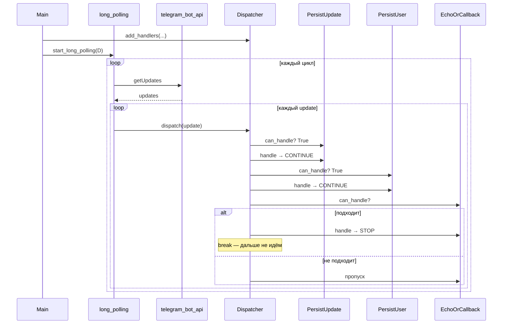
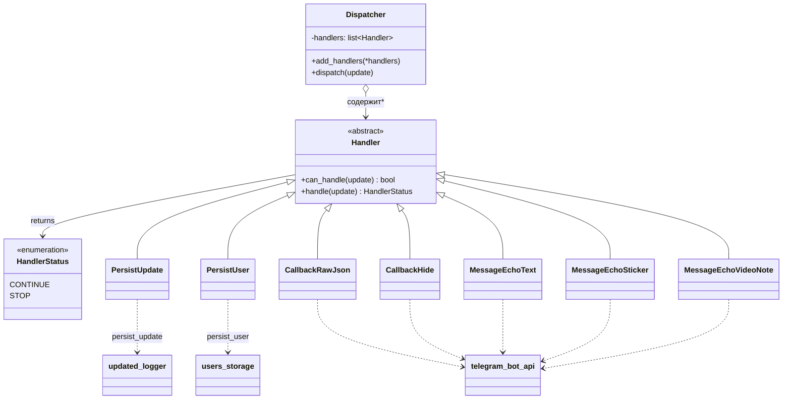
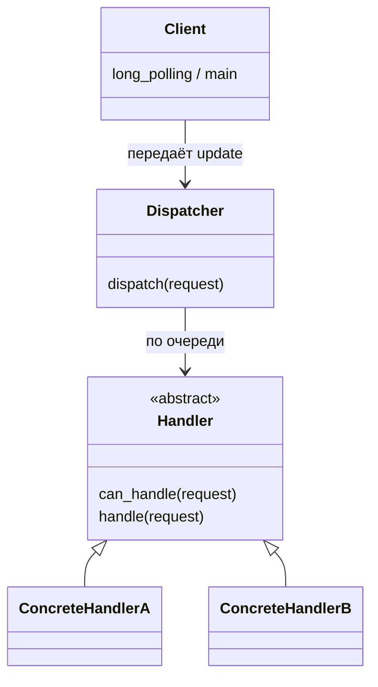

# Архитектура: Dispatcher / Handler

Диаграммы к шагу 10 (тег `2026-fall-07-step-11`). Паттерн — [цепочка обязанностей](https://refactoring.guru/ru/design-patterns/chain-of-responsibility); контракт handlers — [`abc`](https://docs.python.org/3/library/abc.html).

## Как это работает во времени (для доски)

Persist-handlers всегда срабатывают и возвращают `CONTINUE`. Узкий echo/callback при совпадении возвращает `STOP` — цепочка обрывается.

## UML-подобная диаграмма структуры

## Упрощённый вид «только паттерн» для слайда

